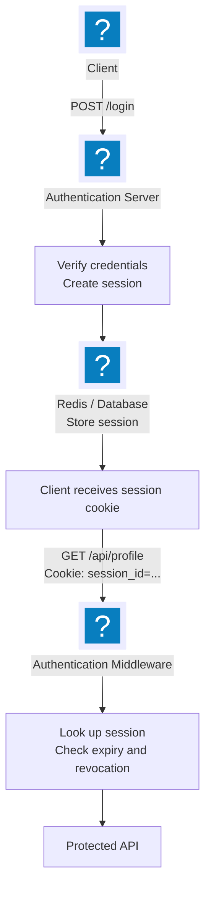
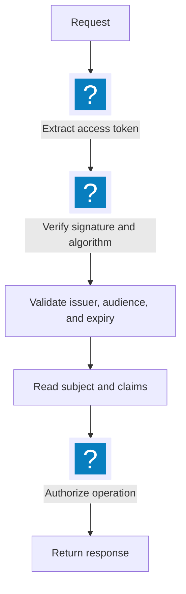
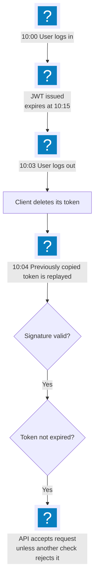
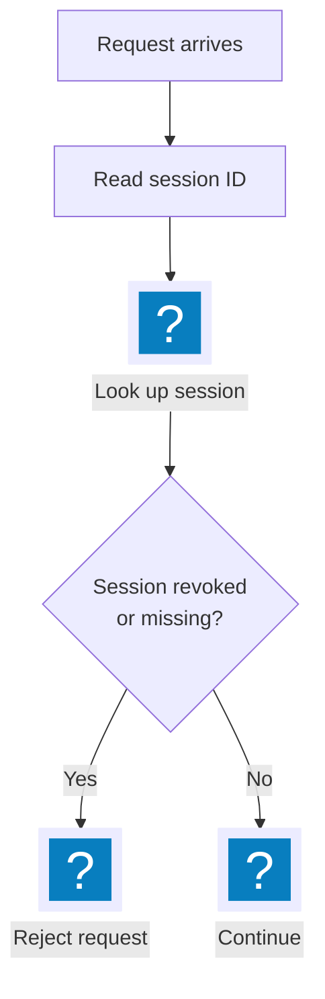
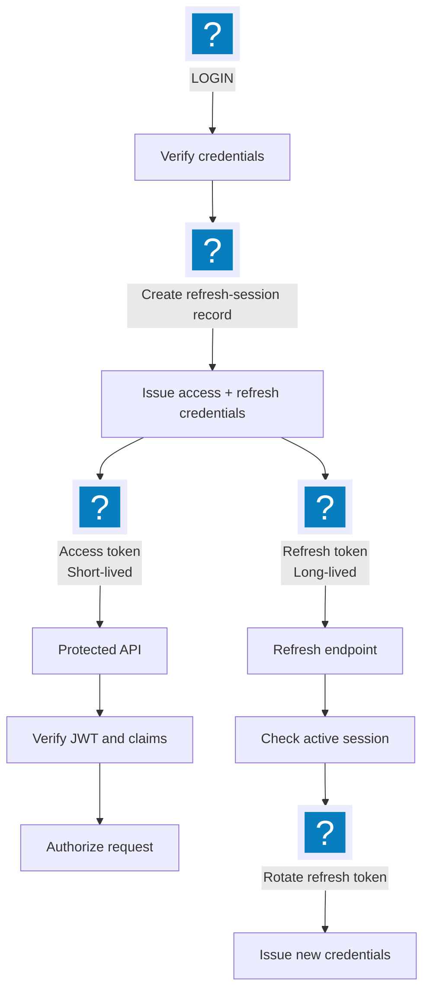
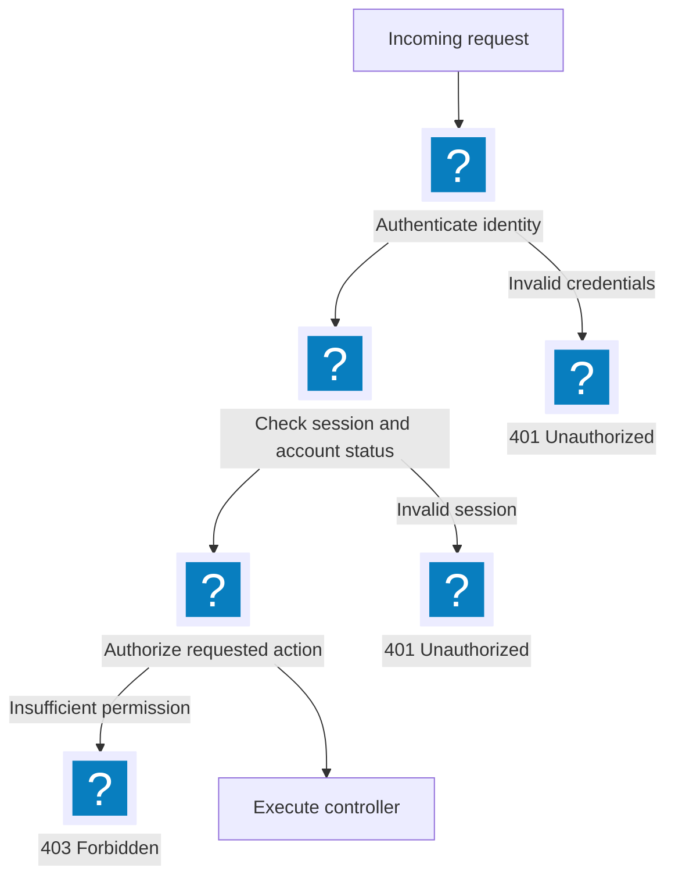
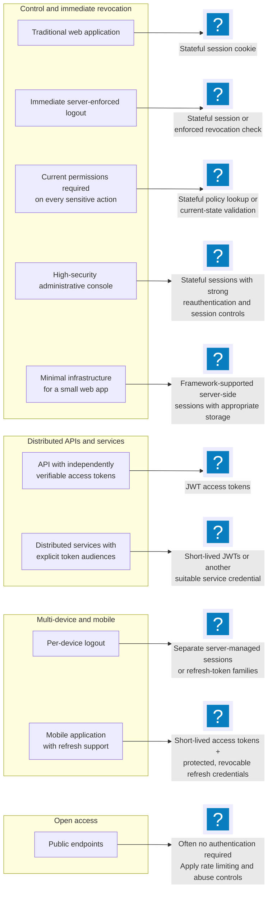

## Introduction

Authentication is one of the first things developers implement when building a backend application. You create a login endpoint, verify the user's credentials, issue a token or session ID, and protect your API routes with middleware.

At first, both stateful and stateless authentication appear straightforward.

With stateful authentication, the server stores a session and gives the client a session ID.

With stateless authentication, the server issues a token, such as a JSON Web Token (JWT), that the client sends with subsequent requests.

But production authentication introduces more difficult questions:

- What happens when a user logs out but their JWT remains valid for another 12 minutes?
- How do you revoke access when a user's account is compromised?
- What happens when an administrator changes a user's role while their token still contains the old role?
- How do you invalidate one device's session without logging out every other device?
- What happens when Redis becomes unavailable?
- How do you prevent a stolen refresh token from being reused?
- Can you scale authentication across multiple API servers without introducing security problems?

These questions reveal the fundamental difference between stateful and stateless authentication.

**The real decision is not simply whether to use JWTs or cookies. It is where authentication state lives, how the server validates it, and how quickly the system can respond when that state changes.**

This guide explores both approaches, their trade-offs, common implementation mistakes, and how to choose the right architecture for a production backend.

## 1. What Is Stateful Authentication?

Stateful authentication is an approach in which the server maintains information about an authenticated user's session.

After a successful login, the server creates a session and stores it in a session store, such as Redis or a relational database. The client receives a session identifier, which it sends with subsequent requests.

The identifier does not need to contain the user's identity or permissions. It simply allows the server to retrieve the corresponding session.

### How stateful authentication works

Consider a user logging into an application.

1. The client submits its email and password.
2. The server verifies the credentials.
3. The server creates a new session with a unique, unpredictable session ID.
4. The session is stored in Redis or a database.
5. The server sends the session ID to the client, commonly through a secure cookie.
6. The client includes that cookie in subsequent requests.
7. Middleware retrieves the session, checks its validity, and identifies the user.
8. When the user logs out, the server invalidates the session.

The process looks like this:


### Example session record

A simplified session stored in Redis might contain:

```json
{
  "sessionId": "random-session-identifier",
  "userId": "user_42",
  "createdAt": "2026-10-11T04:00:00.000Z",
  "expiresAt": "2026-10-11T12:00:00.000Z",
  "lastActivityAt": "2026-10-11T05:30:00.000Z"
}
```

In a real implementation, the session ID should be a cryptographically secure random value. If Redis keys contain the session ID, storing a hash of that identifier instead can reduce the impact of a session-store disclosure.

The cookie should contain only the opaque identifier, not the entire session object.

### What happens during a request?

Suppose the client sends:

```http
GET /api/profile
Cookie: __Host-session=<opaque-session-id>
```

The server retrieves the session and checks:

- Does the session exist?
- Has it expired?
- Has it been revoked?
- Is the associated account still permitted to authenticate?
- Does the user have permission to access this resource?

If the session is valid, the server resolves the user and proceeds with authorization.

### Advantages of stateful authentication

**Immediate session revocation**

The server can invalidate a session at logout or when a security incident occurs. Subsequent requests that check the session store will reject it.

**Centralized session management**

The application can list active sessions, terminate individual devices, and enforce limits on concurrent sessions.

**Flexible authorization**

The server can load current account status and permissions rather than relying entirely on claims captured at login.

**Better control over security events**

A password change, account suspension, or administrator action can invalidate relevant sessions.

### Disadvantages of stateful authentication

**Additional infrastructure**

Sessions require a store or another reliable mechanism for maintaining session state.

**Request-time lookups**

A protected request often requires a Redis or database lookup. Caching can improve performance, but cached state introduces revocation delays.

**Distributed coordination**

All application instances must consult a consistent session system. A session stored only in one server's memory will not automatically be available to another instance.

**Operational complexity**

The session store needs monitoring, expiry policies, capacity planning, and failure handling.

These trade-offs are manageable. Stateful authentication is widely suitable for web applications where centralized control over user sessions matters more than avoiding a session lookup.


## 2. What Is Stateless Authentication?

Stateless authentication is an approach in which the server can authenticate requests without maintaining a separate server-side session record for every authenticated client.

JWTs are a common implementation.

After a successful login, the server issues a signed token containing claims about the authenticated identity. The client sends that token with subsequent requests, and the server verifies it.

### How stateless authentication works

1. The client submits its credentials.
2. The server verifies the credentials.
3. The server issues a signed JWT.
4. The client stores the token.
5. The client sends the token with subsequent requests.
6. The server verifies the signature, expiry, issuer, audience, and other required claims.
7. If the token is valid, the server uses its claims to establish the authenticated identity.

Example:

```http
GET /api/profile
Authorization: Bearer <access-token>
```

A simplified JWT payload might contain:

```json
{
  "sub": "user_42",
  "role": "student",
  "iss": "https://auth.example.com",
  "aud": "example-api",
  "iat": 1791691200,
  "exp": 1791692100
}
```

Here:

- `sub` identifies the subject.
- `role` is a custom authorization claim.
- `iss` identifies the issuer.
- `aud` identifies the intended audience.
- `iat` records when the token was issued.
- `exp` defines when the token expires.

The actual token also includes a header and a cryptographic signature.

### Why can the server verify a JWT without storing it?

The server uses a trusted signing key to verify that the token has not been modified and was signed by an accepted issuer.

If the signature and required claims are valid, the server can trust the token's authenticated claims according to its security policy.

For example:



The server does not need a database query merely to establish that the token was correctly signed and has not expired.

However, this assumes the application does not need a current database lookup, revocation check, or other stateful validation for that request.

### Advantages of stateless authentication

- No per-session lookup is required for ordinary token verification.
- Multiple API servers can independently verify the same token.
- JWTs can carry identity and limited authorization claims.
- The pattern works well across distributed services when issuers, audiences, and keys are configured correctly.
- It can reduce authentication-related database traffic.

### Disadvantages of stateless authentication

- A valid token generally remains usable until expiry unless an additional revocation mechanism is implemented.
- Role changes and account suspensions may not be reflected in existing claims.
- Stolen tokens can be replayed until they expire or are otherwise rejected.
- Token storage on the client becomes a security concern.
- Signing-key management and token validation must be implemented carefully.
- Long-lived tokens increase the impact of theft.

The critical point is that **a valid signature does not mean a user should retain access forever, or even that their account is still active**. It means the token's integrity can be verified. Other policy checks may still be necessary.


## 3. Stateful vs Stateless Authentication: The Real Differences

The most important distinction is whether the server needs to consult maintained authentication state for each protected request.

| Feature | Stateful sessions | Stateless access tokens |
|---|---|---|
| Server-side session record | Required | Not required for basic verification |
| Client credential | Usually opaque session ID | Often a signed JWT |
| Request validation | Session lookup and policy checks | Signature and claim validation |
| Immediate logout | Invalidate session | Requires revocation or another stateful check |
| Multi-device logout | Invalidate selected sessions | Requires tracking or revoking relevant credentials |
| Permission changes | Can take effect on the next policy check | Old token claims may remain unchanged |
| Horizontal scaling | Requires shared session state | Token verification can be distributed |
| Credential size | Usually small identifier | JWT may be larger |
| Revocation complexity | Relatively straightforward | Depends on chosen revocation strategy |
| Store outage | May prevent authentication | Basic JWT verification may continue, unless stateful checks are required |
| Typical use | Web applications and administrative panels | APIs, service-to-service access, distributed systems |

Neither approach is inherently more secure in every scenario.

A poorly configured session system can be vulnerable to session fixation, theft, or cross-site request forgery. A poorly implemented JWT system can suffer from token theft, replay, weak validation, or ineffective revocation.

Security depends on the complete implementation.


## 4. The Logout Problem: Why a Valid JWT Can Be Dangerous

Consider this scenario.

A backend issues an access token that expires in 15 minutes.

At 10:00 AM, a user logs in and receives the token.

At 10:03 AM, the user logs out.

The token expires at 10:15 AM.

What happens if someone sends the same token to a protected API at 10:04 AM?

If the API only verifies the JWT signature and expiry, the request can still succeed.

Why?

Because logout did not change the token's signature, expiration, or claims. The server has no record indicating that the user has logged out.



Deleting the token from the browser only removes that copy. It does not invalidate copies stored elsewhere.

This is the difference between **client-side logout** and **server-enforced revocation**.

### Solution 1: Use stateful sessions

With server-side sessions, logout invalidates the session record.



If the session store is checked on every protected request, subsequent requests using the revoked session will fail.

This is a strong fit when immediate logout and centralized control are important.

### Solution 2: Maintain a JWT denylist

If the application uses JWT access tokens but needs revocation before expiry, it can maintain a denylist.

One approach is to include a unique token identifier (`jti`) in every access token.

On logout:

1. Validate the token sufficiently to identify it safely.
2. Extract its `jti` and expiration.
3. Add the identifier to a denylist, typically Redis.
4. Set the record's TTL to the remaining token lifetime.
5. Check the denylist during subsequent protected requests.

For example:

```text
revoked:<jti> -> 1
TTL = seconds until token expiry
```

Middleware rejects the token if its identifier is present.

The denylist should use a stable identifier that cannot be confused with another token. Hashing the identifier before using it as a Redis key can also be useful.

**Trade-off:** This makes authentication stateful at the revocation-check layer. The system still uses JWTs, but no longer relies exclusively on stateless verification.

A denylist is also only effective if every relevant API checks it consistently.

### Solution 3: Use short-lived access tokens and revocable refresh sessions

Another common architecture uses:

- Short-lived JWT access tokens.
- Longer-lived refresh credentials.
- Server-side storage for refresh sessions.
- Refresh-token rotation and reuse detection.

On logout, the server revokes the refresh session. This prevents the client from obtaining new access tokens through that session.

However, **revoking a refresh token does not automatically invalidate an already-issued access token**. If that access token remains valid for 10 more minutes, it may still be accepted unless the API checks revocation or session state.

This approach limits the exposure window while avoiding a central lookup for every access-token verification.


## 5. Is JWT Authentication Truly Stateless?

Not always.

The term "JWT authentication" describes the credential format and often a verification approach. It does not dictate the complete architecture.

Consider three systems:

**System A: Pure stateless access-token verification**

The API validates the JWT signature and claims without consulting a per-user session record. It may not support immediate revocation.

**System B: JWT with a denylist**

The API verifies the JWT and queries Redis to determine whether the token has been revoked.

**System C: JWT with session-version or account-state checks**

The API verifies the JWT and compares a claim against current server-side state.

Systems B and C use JWTs, but they are not fully stateless for authentication decisions.

This is not a flaw. It is a design choice.

A useful way to think about authentication is to separate three questions:

1. **Credential validity:** Is this token authentic and within its validity period?
2. **Session validity:** Has the session or credential been revoked?
3. **Authorization validity:** Is this user currently allowed to perform this action?

A signature check primarily answers the first question. A production system may need to answer all three.


## 6. A Practical Hybrid Architecture

For many applications, a hybrid approach provides a useful balance between performance and control.

A common design includes:

- Short-lived JWT access tokens.
- Opaque refresh tokens or another revocable refresh credential.
- Server-side refresh-session records in Redis or a database.
- Secure cookie storage for browser-based applications where appropriate.
- Optional server-side checks for high-risk operations.
- Refresh-token rotation and reuse detection.
- Centralized session revocation.

The flow looks like this:



On logout, the server revokes the refresh session and clears the client-side credential.

If the product requires already-issued access tokens to stop working immediately, the API must also enforce access-token revocation or session validity.

### Why not use one token for everything?

Using one long-lived token for both ordinary API access and session renewal combines two different responsibilities.

A better separation is:

- Access credentials should be short-lived and narrowly scoped.
- Refresh credentials should be protected carefully and used only to obtain new access credentials.
- Session state should be maintained wherever revocation, device management, or current account status requires it.

This separation reduces the damage caused by a leaked access token and allows refresh sessions to be revoked centrally.


## 7. Authentication and Authorization Are Different

Authentication answers:

> Who is making this request?

Authorization answers:

> Is this identity allowed to perform this operation?

For example, a student may be authenticated but not authorized to delete another student's record.

A secure middleware pipeline should distinguish these responsibilities.



HTTP semantics matter:

- **401 Unauthorized:** The request lacks valid authentication credentials.
- **403 Forbidden:** The caller is authenticated but is not permitted to perform the requested action.

Applications may deliberately return a generic response in certain cases to avoid leaking information, but the underlying security decision must remain correct.

### Why trusting the role inside a JWT can be dangerous

Suppose a user logs in with this claim:

```json
{
  "sub": "user_42",
  "role": "admin"
}
```

Later, an administrator downgrades the account to `user`.

The existing JWT still contains `role: admin`. Signature verification will not update the claim.

Possible solutions include:

- Short access-token lifetimes.
- Current-role lookup for sensitive operations.
- A session or authorization version that can be invalidated.
- Revocation of relevant sessions or tokens.
- Policy checks against current resource ownership and permissions.

For ordinary low-risk operations, a short delay before updated permissions take effect may be acceptable. For privileged operations, financial transactions, and sensitive administrative actions, relying solely on stale role claims can be dangerous.


## 8. Important Edge Cases in Production Authentication

A working login endpoint is only the beginning. Authentication must behave correctly under failure, concurrency, and attack conditions.

### 8.1 User logs out from one device

Suppose a user is logged in on a laptop and a phone.

Logging out on the laptop should usually terminate only that session.

With stateful sessions, each device can have its own session record.

With JWTs, device-specific logout requires a way to revoke the relevant refresh session or access credentials. If all devices share a single account-wide token version, incrementing it may log out every device.

Choose the behavior intentionally.

### 8.2 User selects "Log out of all devices"

The application must invalidate all relevant sessions or refresh credentials.

A session table can support queries by user ID. Redis can maintain per-user session indexes or another suitable structure.

An alternative is an account-wide session version or token-valid-after timestamp, but every relevant request must check the current value for immediate enforcement.

Remember that revoking refresh sessions alone may leave existing access tokens valid until expiry.

### 8.3 Password changes

A password change should normally invalidate existing sessions according to the application's security policy.

For a high-security application, consider revoking all sessions and refresh credentials, requiring reauthentication, and notifying the user.

Changing a password does not automatically invalidate a signed JWT.

### 8.4 Account suspension or deletion

An account may be disabled while its tokens remain unexpired.

If the API only verifies JWT signatures, it may continue to accept those tokens.

For immediate enforcement, check account status or a revocable session/version record. Otherwise, the account remains potentially usable until its credentials expire.

Account deletion should also account for background jobs, API keys, long-lived sessions, and other credentials.

### 8.5 Role or permission changes

JWT claims are snapshots taken at issuance time.

If authorization changes must take effect immediately, fetch current permissions or validate a current authorization version before allowing sensitive operations.

A database lookup on every request may be unnecessary for every application, but privileged operations deserve stricter checks.

### 8.6 Access token expires during a request

Authentication middleware normally checks expiry when the request is authenticated.

If a request has already passed authentication and the token expires while a long-running operation executes, the expiry does not automatically cancel the operation.

For ordinary requests, this is usually acceptable.

For sensitive long-running actions, recheck relevant authorization conditions at the point where the action commits, especially if permissions or account status may have changed.

### 8.7 Clock differences between servers

JWT validation depends on time-based claims such as `exp` and `nbf`.

If server clocks differ, a token may appear expired or not yet valid on some instances.

Use reliable time synchronization, reject invalid time claims, and configure only a small, deliberate clock-skew allowance where necessary. Do not use excessive tolerance to hide clock problems.

### 8.8 Redis becomes unavailable

Stateful authentication introduces a dependency on the session store.

If the session store is unavailable, the application cannot reliably determine whether sessions are active.

For protected endpoints, a secure default is generally to fail closed: do not grant access when required session validation cannot be completed.

Public endpoints may continue to work. Health checks and operational endpoints should be designed separately.

Do not silently skip revocation checks during an outage if immediate revocation is part of your security guarantee.

### 8.9 A revoked session is cached

Suppose an API instance caches session validity for 30 seconds.

A session is revoked, but the instance continues using its cached positive result.

The revocation is not immediate.

Possible solutions include shorter cache lifetimes, explicit invalidation, centralized lookups, or carefully designed event-driven invalidation. Even event-driven approaches need to account for lost events and disconnected instances.

Define an acceptable revocation delay and design around it.

### 8.10 Multiple concurrent requests

A browser may send several requests simultaneously while a user logs out.

One request may already have passed authentication when another invalidates the session.

Revocation generally prevents future authorization checks from succeeding; it does not necessarily cancel work already authorized or completed.

For sensitive operations, validate relevant state close to the operation's commit point and use database transactions or other concurrency controls where needed.

### 8.11 Session fixation

An attacker may try to cause a victim to use a session identifier known to the attacker.

Mitigation:

- Generate a new session ID after successful authentication.
- Rotate the session ID after privilege changes where appropriate.
- Never accept arbitrary client-chosen session IDs as trusted credentials.
- Configure cookies securely.

### 8.12 Session theft

If an attacker steals a session cookie, the attacker may be able to impersonate the user.

Mitigation:

- Use HTTPS.
- Set `Secure`, `HttpOnly`, and an appropriate `SameSite` attribute.
- Avoid exposing session identifiers in URLs or logs.
- Apply suitable idle and absolute session timeouts.
- Revoke sessions after suspected compromise.
- Consider additional verification for high-risk actions.

### 8.13 JWT theft

A stolen bearer token can be replayed by anyone who possesses it until the server rejects it.

JWT signatures prevent unauthorized modification, not replay by a thief.

Mitigation includes short lifetimes, secure token storage, TLS, restricted audiences and scopes, refresh-token rotation, and revocation where necessary.

### 8.14 Refresh-token replay

Suppose a refresh token is stolen and the attacker uses it to obtain a new token.

With refresh-token rotation, every successful refresh invalidates the previous refresh token and issues a replacement.

If the old token is reused, the server can detect a possible replay and revoke the affected token family or session.

Rotation must be implemented with concurrency in mind. Two legitimate simultaneous refresh requests can otherwise look like reuse. A robust implementation defines how concurrent refreshes are serialized or reconciled without creating a replay loophole.

### 8.15 Cross-site request forgery (CSRF)

Browsers automatically attach eligible cookies to requests. This creates CSRF risk for cookie-based authentication.

Use appropriate `SameSite` cookie settings, CSRF tokens where required, and Origin or Referer validation as part of a deliberate policy.

`SameSite` is helpful but should not be treated as a universal replacement for CSRF defenses.

Bearer tokens attached explicitly by application code generally have a different CSRF profile, but their storage and exposure to cross-site scripting must be considered.

### 8.16 Cross-site scripting (XSS)

An attacker who executes JavaScript in an application's origin may be able to steal tokens stored in JavaScript-accessible storage or make authenticated requests as the victim.

`HttpOnly` prevents JavaScript from directly reading a cookie, but it does not prevent malicious same-origin JavaScript from issuing requests that use the cookie.

Use output encoding, safe DOM APIs, a suitable Content Security Policy, dependency hygiene, and secure cookie configuration.

### 8.17 JWT algorithm and claim validation

Never treat a JWT as trustworthy merely because it can be decoded.

A robust verifier should:

- Allow only explicitly configured signing algorithms.
- Verify the signature using the expected key.
- Validate issuer and audience.
- Validate expiry and other required time claims.
- Reject malformed tokens.
- Validate required claim types and formats.
- Enforce token purpose and permitted scopes.
- Handle signing-key rotation safely.

Do not accept arbitrary algorithms or blindly trust token-supplied key locations.

### 8.18 Signing-key compromise

If a signing key is compromised, an attacker may be able to forge tokens.

A response may require rotating keys, rejecting tokens signed by the compromised key, revoking sessions, and investigating misuse.

Key rotation should support a controlled overlap between old and new keys where appropriate, while still allowing compromised keys to be rejected immediately.

### 8.19 Database restore or Redis data loss

A database rollback or Redis data loss may cause session records or revocation information to disappear.

If missing records cause authentication to fail, users may be logged out, which is inconvenient but often safe.

If the application assumes a missing revocation record means a credential is trusted, data loss may accidentally restore access.

Design the data model and failure behavior so that lost security state does not silently reauthorize revoked credentials.

### 8.20 Multiple services and audiences

A token intended for one API should not automatically be accepted by another.

Validate the intended audience and issuer. Use appropriately scoped credentials, and avoid sharing signing secrets unnecessarily between services.

Service-to-service authentication also needs clear identity, authorization, credential rotation, and revocation policies.


## 9. Access Tokens vs Refresh Tokens

These two credentials serve different purposes.

| Property | Access token | Refresh token |
|---|---|---|
| Purpose | Access protected resources | Obtain new access credentials |
| Lifetime | Usually short | Usually longer |
| Sent to | Resource API | Authentication/refresh endpoint |
| Storage | Protected client storage | Strongly protected storage |
| Revocation | Optional or required depending on policy | Usually centrally managed |
| Rotation | Not normally rotated on every request | Rotation is a common best practice |

A refresh token should not be accepted as an access token.

Refresh endpoints should validate the token's session, expiry, revocation state, and intended use. They should also apply rate limiting and suitable abuse detection.

A refresh-token record might contain:

```json
{
  "userId": "user_42",
  "sessionId": "session_abc",
  "tokenHash": "stored-hash-of-refresh-token",
  "expiresAt": "2026-11-11T10:00:00.000Z",
  "revokedAt": null
}
```

In practice, refresh-token rotation may require tracking token families, parent-child relationships, or consumed-token identifiers to detect reuse.

Opaque random refresh tokens are often simpler to revoke than self-contained refresh JWTs because their validity is deliberately tied to server-side state.


## 10. Cookies vs Authorization Headers

A common misconception is that cookies mean stateful authentication and bearer tokens mean stateless authentication.

That is incorrect.

Cookies and Authorization headers are credential transport mechanisms. Stateful and stateless authentication describe how the server manages and validates authentication state.

A session ID can be sent in a cookie. A JWT can also be sent in a cookie.

Likewise, a bearer token can represent a stateful session if the server looks it up in a database.

### Cookie-based authentication

For browser-based applications, a session cookie can be configured with:

```http
Set-Cookie: __Host-session=<opaque-id>; Path=/; Secure; HttpOnly; SameSite=Lax
```

The `__Host-` prefix has specific browser requirements, including `Secure`, `Path=/`, and no `Domain` attribute.

Cookie attributes should be selected according to the application's deployment and cross-site requirements.

### Bearer-token authentication

An API client may send:

```http
Authorization: Bearer <access-token>
```

This is common for APIs, mobile applications, and service clients.

Do not put bearer tokens in URLs because URLs can leak through browser history, access logs, analytics, and referrer headers.

### Where should browser tokens be stored?

There is no universal storage choice for every application.

- `HttpOnly` cookies reduce direct JavaScript access to credentials.
- Browser storage accessible to JavaScript can expose tokens to XSS.
- Cookies introduce CSRF considerations because browsers attach them automatically under applicable conditions.

For a traditional browser application, an opaque session cookie is often a straightforward choice. For a browser application using JWTs, an `HttpOnly` cookie combined with proper CSRF defenses can be appropriate.

Choose based on the threat model rather than assuming one storage method is universally secure.


## 11. Implementing Stateful Authentication in a Backend

A typical stateful implementation has five main components.

### 11.1 Session storage

A relational session table might look like:

```sql
CREATE TABLE sessions (
    id UUID PRIMARY KEY,
    user_id UUID NOT NULL REFERENCES users(id),
    created_at TIMESTAMPTZ NOT NULL DEFAULT NOW(),
    expires_at TIMESTAMPTZ NOT NULL,
    revoked_at TIMESTAMPTZ,
    last_activity_at TIMESTAMPTZ
);

CREATE INDEX sessions_user_id_idx
    ON sessions(user_id);
```

This is a simplified schema. A production design may include device metadata, session rotation history, and additional indexes.

If the session ID itself is used as the database primary key, consider storing a cryptographic hash of the client-facing session ID instead of the raw value.

### 11.2 Login

After validating credentials:

1. Generate a cryptographically secure random session ID.
2. Store the session record.
3. Set a cookie containing the identifier.
4. Apply the required cookie attributes.
5. Return a response without exposing internal session data.

Regenerate the session identifier after authentication to prevent session fixation.

### 11.3 Authentication middleware

Conceptually:

```ts
async function authenticate(req, res, next) {
  const sessionId = readSessionCookie(req);

  if (!sessionId) {
    return res.status(401).json({
      message: "Authentication required",
    });
  }

  const session = await sessionStore.findActive(sessionId);

  if (!session) {
    return res.status(401).json({
      message: "Invalid or expired session",
    });
  }

  const user = await users.findById(session.userId);

  if (!user || !user.isActive) {
    return res.status(401).json({
      message: "Invalid or expired session",
    });
  }

  req.user = user;
  req.session = session;

  return next();
}
```

This is illustrative TypeScript, not a drop-in implementation. The actual session lookup must enforce expiry and revocation, and `readSessionCookie` must validate the incoming credential appropriately.

Error handling must also account for storage failures. If the session store cannot be reached, the application should not treat the session as valid merely because validation failed to run.

### 11.4 Authorization middleware

Authentication should establish the identity first. Authorization then checks the requested operation.

For example:

```ts
function requireRole(...allowedRoles: string[]) {
  return (req, res, next) => {
    if (!req.user) {
      return res.status(401).json({
        message: "Authentication required",
      });
    }

    if (!allowedRoles.includes(req.user.role)) {
      return res.status(403).json({
        message: "Insufficient permissions",
      });
    }

    return next();
  };
}
```

For sensitive operations, the user's current role and permissions should be authoritative. Do not assume a role captured in a long-lived session can never change.

### 11.5 Logout

Logout should invalidate the server-side session and clear the cookie.

```ts
async function logout(req, res) {
  const sessionId = readSessionCookie(req);

  if (sessionId) {
    await sessionStore.revoke(sessionId);
  }

  res.clearCookie("__Host-session", {
    path: "/",
    secure: true,
    httpOnly: true,
    sameSite: "lax",
  });

  return res.status(204).end();
}
```

The cookie-clearing options should match the original cookie's applicable attributes. If the server cannot revoke the session because the session store is unavailable, it should not claim that server-side revocation succeeded.

Logout should also be designed to be safely repeatable. Clearing a cookie and revoking an already-revoked session should not cause unexpected behavior.


## 12. Implementing JWT Authentication Correctly

A basic JWT authentication flow consists of token issuance, verification, authorization, and an explicit revocation policy.

### 12.1 Token issuance

After credential verification, issue a token with a limited lifetime and the necessary claims.

Conceptually:

```ts
const accessToken = sign(
  {
    sub: user.id,
    role: user.role,
    iss: "https://auth.example.com",
    aud: "example-api",
  },
  signingKey,
  {
    algorithm: "RS256",
    expiresIn: "10m",
  }
);
```

This example assumes the signing library supports the shown API and that the issuer, audience, key, and algorithm are configured correctly. The values should be explicit and appropriate for the deployment.

Do not put passwords, refresh tokens, or sensitive personal information in the payload. Signed JWT payloads are not confidential by default.

### 12.2 Token verification

The verification process must validate more than the signature.

```ts
const claims = verify(accessToken, publicKey, {
  algorithms: ["RS256"],
  issuer: "https://auth.example.com",
  audience: "example-api",
});
```

The precise API depends on the JWT library. Also validate required claims, token purpose, and application-specific rules.

Do not trust a decoded token before successful verification.

### 12.3 Revocation

If immediate logout is required, add a revocation mechanism, such as:

- A denylist keyed by token identifier.
- A server-side session identifier claim.
- A current account or session version check.
- Short-lived access tokens plus revocable refresh sessions, if delayed access-token revocation is acceptable.

Choose one deliberately based on the application's security requirements.

### 12.4 Key rotation

Use a defined key-rotation process. With asymmetric signing, the issuer holds the private key while resource servers can verify tokens using trusted public keys.

Resource servers should accept only known keys and supported algorithms. The token's key identifier can help select a trusted verification key, but it must not let the token dictate an arbitrary key source.


## 13. Performance and Scalability

Authentication is part of the request path, so its performance and failure characteristics matter.

### Stateful sessions with Redis

Redis can provide low-latency session lookups and automatic expiration through TTLs.

For distributed systems:

- All API instances must use a shared session system.
- Session writes and revocations must have clearly defined consistency guarantees.
- Redis persistence, replication, failover, and recovery settings must match the security requirements.
- Session-store access should be monitored and protected.

Redis is not automatically durable or strongly consistent under every configuration. If losing session state could restore access, design recovery and revocation policies accordingly.

### Stateful sessions with a relational database

A relational database can be a good fit when the application needs audit history, device management, administrative session controls, or durable session records.

Use appropriate indexes and expiry cleanup. Consider whether session queries will create unnecessary load on the primary database.

### Stateless JWT verification

Signature verification can be performed locally on each API instance. This can reduce request-time database traffic.

However, JWTs do not eliminate all scaling concerns. The application still needs key distribution, rotation, observability, authorization policy, and potentially revocation checks.

### The consistency trade-off

Suppose a user is revoked at 10:00:00, but a cache remains valid until 10:00:30.

Some requests may continue to succeed during that interval.

This is not just a performance detail. It is part of the security contract.

Define whether revocation must be immediate, bounded by a small delay, or effective only at token expiry. Then ensure the infrastructure supports that guarantee.


## 14. Common Authentication Mistakes

Avoid these mistakes when designing authentication:

1. **Assuming JWT logout is automatic.** Deleting a token in the browser does not invalidate copies elsewhere.
2. **Using very long-lived access tokens.** Token theft has a longer window of impact.
3. **Treating JWT payloads as encrypted data.** Signing does not provide confidentiality.
4. **Trusting decoded tokens without verifying them.** Always validate the signature and required claims.
5. **Ignoring account status.** A disabled account may retain valid credentials.
6. **Relying on stale role claims.** Current permissions may differ from the claims issued at login.
7. **Storing raw refresh tokens unnecessarily.** Store a suitable cryptographic hash when practical.
8. **Failing to rotate refresh tokens.** Reusable long-lived refresh credentials are harder to protect.
9. **Ignoring CSRF with cookie authentication.** Cookies are automatically attached under applicable browser rules.
10. **Ignoring XSS with browser token storage.** JavaScript-accessible credentials can be exposed.
11. **Using process memory for production sessions.** Different instances will not share the same state, and restarts can destroy sessions.
12. **Failing open when Redis is unavailable.** Required revocation checks must not be silently skipped.
13. **Caching positive session checks without considering revocation.** This can delay logout enforcement.
14. **Confusing 401 and 403.** Authentication failure and authorization failure are different conditions.
15. **Failing to protect refresh endpoints.** Refresh tokens need their own validation, rate limiting, and replay controls.
16. **Ignoring in-flight requests.** Revocation does not automatically cancel work already authorized.
17. **Using one audience for every service without a reason.** Tokens should be accepted only by their intended recipients.
18. **Leaving authentication events unmonitored.** Login failures, refresh-token reuse, unusual session creation, and revocation failures can reveal attacks.


## 15. Which Approach Should You Choose?

There is no universal winner. Choose based on the behavior the application needs.

### Choose stateful sessions when:

- You are building a traditional browser-based application.
- Immediate logout is important.
- You need per-device session management.
- Administrators must revoke user access centrally.
- Account status and permissions need to take effect quickly.
- You want a relatively straightforward model for session lifecycle management.

### Choose stateless access tokens when:

- You have multiple APIs that need independent token verification.
- Local token verification is a meaningful architectural benefit.
- Short-lived credentials fit the application's security requirements.
- The system can tolerate the defined revocation window or has a separate revocation mechanism.
- Your team can manage signing keys and token validation correctly.

### Choose a hybrid approach when:

- You need JWT access tokens for API requests.
- You want refresh credentials to be revocable.
- You need device-specific sessions.
- You want to limit database lookups while maintaining some centralized control.
- Your application has both browser and service-client authentication needs.

A hybrid design is often practical for modern backends, but it adds complexity. It should be used because its benefits justify that complexity, not simply because it combines two popular technologies.


## 16. Decision Matrix


These are starting points, not absolute rules. Requirements such as offline access, regulatory obligations, threat models, and infrastructure constraints can change the choice.


## 17. Production Security Checklist

Before deploying an authentication system, verify the following.

### Session management

- [ ] Session IDs are cryptographically random and unpredictable.
- [ ] Session IDs rotate after login and relevant privilege changes.
- [ ] Session cookies use HTTPS and appropriate security attributes.
- [ ] Idle and absolute session timeouts are defined.
- [ ] Logout revokes the server-side session.
- [ ] Multi-device and all-device logout behavior is explicit.
- [ ] Session-store failures do not silently authorize requests.
- [ ] Session expiry and cleanup are implemented.

### JWT security

- [ ] Tokens have an appropriate, limited lifetime.
- [ ] Signatures and permitted algorithms are verified.
- [ ] Issuer, audience, expiry, and required claims are validated.
- [ ] Access and refresh tokens have distinct purposes.
- [ ] Signing keys are protected and rotated.
- [ ] Sensitive information is not placed in ordinary JWT payloads.
- [ ] Token revocation behavior is documented.
- [ ] Role changes and account suspension have a defined enforcement policy.

### Refresh credentials

- [ ] Refresh tokens are protected in client storage.
- [ ] Refresh tokens are revocable.
- [ ] Rotation and reuse detection are implemented where required.
- [ ] Concurrent refresh requests are handled safely.
- [ ] Refresh endpoints have appropriate rate limiting.
- [ ] Logout and account compromise invalidate relevant refresh sessions.

### Authorization and operations

- [ ] Authentication and authorization are separate checks.
- [ ] Resource ownership is checked where relevant.
- [ ] High-risk operations use current permissions.
- [ ] CSRF defenses are applied where appropriate.
- [ ] XSS defenses are part of the frontend security strategy.
- [ ] Authentication events and failures are monitored.
- [ ] Revocation consistency and infrastructure failure behavior are tested.


## Conclusion

Stateful and stateless authentication solve the same broad problem—establishing a user's identity—but they manage authentication state differently.

Stateful authentication relies on a server-managed session. It offers direct control over session revocation, logout, and device management, at the cost of maintaining and checking session state.

Stateless authentication allows the server to verify credentials such as JWTs without a per-session lookup. It can simplify distributed token verification, but a valid token does not automatically become invalid when the user logs out, changes roles, or has their account suspended.

The most important lesson is this:

**A valid JWT is not the same as an active session, and an authenticated user is not automatically authorized to perform every action.**

Before choosing an authentication strategy, define the expected behavior for logout, revocation, account suspension, permission changes, token theft, refresh-token replay, and infrastructure failures.

Then design the system around those requirements.

The goal is not to make authentication entirely stateful or entirely stateless. The goal is to make the security guarantees explicit, enforce them consistently, and choose the simplest architecture that meets them.


### Further Reading

- [RFC 7519 : SON Web Token (JWT)](https://www.rfc-editor.org/rfc/rfc7519)
- [RFC 8725 : JSON Web Token Best Current Practices](https://www.rfc-editor.org/rfc/rfc8725)
- [OWASP Session Management Cheat Sheet](https://cheatsheetseries.owasp.org/cheatsheets/Session_Management_Cheat_Sheet.html)
- [OWASP JSON Web Token Cheat Sheet](https://cheatsheetseries.owasp.org/cheatsheets/JSON_Web_Token_for_Java_Cheat_Sheet.html)
- [OWASP Authentication Cheat Sheet](https://cheatsheetseries.owasp.org/cheatsheets/Authentication_Cheat_Sheet.html)
- [RFC 9700 : Best Current Practice for OAuth 2.0 Security](https://www.rfc-editor.org/rfc/rfc9700)


*Authentication sorted. Time to dance.* 🕺


