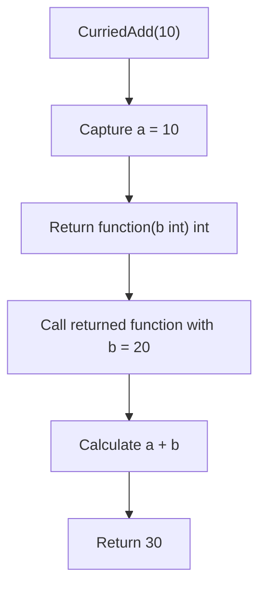
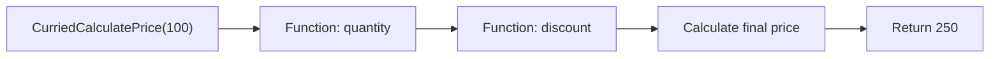
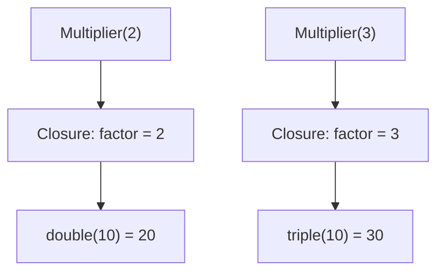
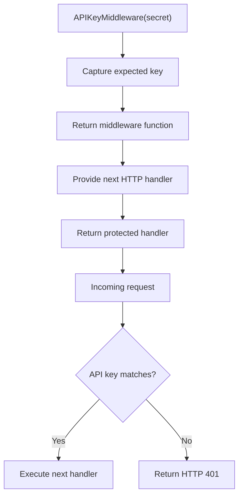

Currying is a functional programming technique that transforms a function taking multiple arguments into a sequence of functions, each accepting a single argument. It helps us build reusable functions, separate configuration from execution, and compose behavior more easily.

Although Go is not a purely functional programming language, its support for first-class functions and closures makes currying straightforward to implement.

This article follows the core concept described in [Wikipedia's article on Currying](https://en.wikipedia.org/wiki/Currying).


## 1. What is currying?

Consider a function that adds two integers:

```go
func Add(a, b int) int {
    return a + b
}

func main() {
    result := Add(10, 20)
    fmt.Println(result) // 30
}
```

The `Add` function accepts two arguments at once: `a` and `b`.

Currying transforms this function into a chain of functions where each function accepts only one argument.

Conceptually, the original function:

```go
Add(a, b) -> int
```

becomes:

```go
Add(a) -> function(b) -> int
```

In Go, we can represent the curried version using a function that returns another function:

```go
func CurriedAdd(a int) func(int) int {
    return func(b int) int {
        return a + b
    }
}
```

Now we can call it like this:

```go
result := CurriedAdd(10)(20)
fmt.Println(result) // 30
```

The first call, `CurriedAdd(10)`, returns a function. The second call passes `20` to that returned function and calculates the result.

The key idea: instead of supplying all arguments at once, we supply them one at a time through a sequence of function calls.

## 2. How currying works

Let's break down the execution of `CurriedAdd(10)(20)`.

Here's what happens at each step:

1. `CurriedAdd(10)` receives the first argument.
2. It returns an anonymous function that accepts one integer.
3. The returned function retains access to `a`, whose value is `10`.
4. We invoke that function with `20`.
5. It calculates `10 + 20` and returns `30`.

The mechanism that allows the returned function to remember `a` is called a closure.

A closure is a function that can access variables from its surrounding lexical scope, even after the outer function has returned.

This is an important concept because closures make currying practical in Go.

## 3. Currying a function with three arguments

Currying is not limited to functions with two arguments. We can apply the same technique to functions with three or more arguments.

Suppose we have a function that calculates the total price of an order:

```go
func CalculatePrice(
    price float64,
    quantity int,
    discount float64,
) float64 {
    return price*float64(quantity) - discount
}
```

The function accepts three arguments and returns the final price.

Its curried equivalent looks like this:

```go
func CurriedCalculatePrice(price float64) func(int) func(float64) float64 {
    return func(quantity int) func(float64) float64 {
        return func(discount float64) float64 {
            return price*float64(quantity) - discount
        }
    }
}
```

We can use it as follows:

```go
total := CurriedCalculatePrice(100)(3)(50)

fmt.Println(total) // 250
```

The evaluation happens in three stages:

- First, we provide the price: `100`.
- Next, we provide the quantity: `3`.
- Finally, we provide the discount: `50`.

The calculation is \\(100 \times 3 - 50 = 250\\).

The function's structure can be represented as:



Notice that each function accepts exactly one argument. Each invocation returns another function until the final argument is supplied.

## 4. Currying vs. regular functions in Go

Let's compare both approaches side by side.

Regular function

```go
func Multiply(a, b int) int {
    return a * b
}

result := Multiply(5, 4)
fmt.Println(result) // 20
```

Curried function

```go
func CurriedMultiply(a int) func(int) int {
    return func(b int) int {
        return a * b
    }
}

result := CurriedMultiply(5)(4)
fmt.Println(result) // 20
```

Both approaches produce the same result, but their interfaces differ.

| Feature      | Regular function           | Curried function                  |
| ------------ | -------------------------- | --------------------------------- |
| Arguments    | Multiple at once           | One per function call             |
| Return value | Final result               | Another function until completion |
| Reuse        | Call with new arguments    | Reuse intermediate functions      |
| Go syntax    | `Multiply(5, 4)`           | `CurriedMultiply(5)(4)`           |
| Typical use  | General-purpose operations | Reusable configured behavior      |

Currying is not automatically better than a regular function. It is useful when separating arguments into stages provides a practical advantage.

## 5. Currying and closures: the relationship

To understand currying properly in Go, we need to understand closures.

Consider this example:

```go
func Multiplier(factor int) func(int) int {
    return func(number int) int {
        return factor * number
    }
}

func main() {
    double := Multiplier(2)
    triple := Multiplier(3)

    fmt.Println(double(10)) // 20
    fmt.Println(triple(10)) // 30
}
```

Here, `Multiplier` creates functions with different behaviors.

When we call `Multiplier(2)`, it returns a function that multiplies its argument by `2`. When we call `Multiplier(3)`, it returns a different function that multiplies by `3`.

The returned functions retain access to their respective `factor` values.


This pattern is useful when creating specialized functions from general-purpose logic.

For example, instead of repeatedly writing multiplication logic, we can create reusable `double`, `triple`, or `tenTimes` functions.

Strictly speaking, a closure is the mechanism used to retain the surrounding state in these examples; currying is the transformation that organizes arguments into successive single-argument functions.

## 6. A practical example: HTTP middleware in Go

One useful application of this pattern is configuring HTTP middleware.

Imagine that we want middleware that checks whether an incoming request contains a particular API key.

Without currying, we might create separate middleware implementations for different API keys. That approach duplicates logic unnecessarily.

Instead, we can create a function that accepts the API key and returns middleware.

```go
package main

import (
    "net/http"
)

func APIKeyMiddleware(
    expectedKey string,
) func(http.Handler) http.Handler {
    return func(next http.Handler) http.Handler {
        return http.HandlerFunc(func(
            w http.ResponseWriter,
            r *http.Request,
        ) {
            key := r.Header.Get("X-API-Key")

            if key != expectedKey {
                http.Error(
                    w,
                    "Unauthorized",
                    http.StatusUnauthorized,
                )
                return
            }

            next.ServeHTTP(w, r)
        })
    }
}
```

We can configure the middleware once and reuse it:

```go
apiKeyAuth := APIKeyMiddleware("my-secret-key")

protectedHandler := apiKeyAuth(
    http.HandlerFunc(func(
        w http.ResponseWriter,
        r *http.Request,
    ) {
        w.Write([]byte("Access granted"))
    }),
)
```

The function call follows this structure:

```go
APIKeyMiddleware(key)
    -> middleware(http.Handler)
        -> http.Handler
```

The first call configures the expected key. The second supplies the handler that should be protected.


This is an example of staged function configuration and execution. It is commonly implemented with closures and has a curried function shape.

Important: this example demonstrates the pattern, not a complete production authentication system. A real API should load secrets from secure configuration, avoid hardcoded credentials, use HTTPS, and apply appropriate authentication and authorization policies.

## 7. A practical example: a reusable logger

Suppose we want to log messages with different levels, such as `INFO`, `WARN`, and `ERROR`.

We can create a function that captures a log level and returns a function for logging messages.

```go
package main

import (
    "fmt"
    "time"
)

func Logger(level string) func(string) {
    return func(message string) {
        fmt.Printf(
            "[%s] [%s] %s\n",
            time.Now().Format(time.RFC3339),
            level,
            message,
        )
    }
}

func main() {
    info := Logger("INFO")
    warn := Logger("WARN")
    errorLog := Logger("ERROR")

    info("Server started")
    warn("Request took longer than expected")
    errorLog("Database connection failed")
}
```

The output will resemble:

```text
[2026-10-13T20:00:00+05:45] [INFO] Server started
[2026-10-13T20:00:00+05:45] [WARN] Request took longer than expected
[2026-10-13T20:00:00+05:45] [ERROR] Database connection failed
```

The timestamp is illustrative; the program generates the actual timestamp when it runs.

The `Logger` function separates configuration from execution:

- Configuration: choose the log level.
- Execution: provide a message whenever logging is needed.

This same pattern can be useful for notification handlers, event processors, metrics, and other reusable components.

## 8. Currying vs. partial application

Currying and partial application are closely related, but they are not the same concept.&#x20;


Currying transforms a multi-argument function into a chain of single-argument functions.

Partial application fixes one or more arguments in advance and returns a function that accepts the remaining arguments.

For example, consider a function that adds three integers.

```go
func AddThree(a, b, c int) int {
    return a + b + c
}
```

We can write a curried version:

```go
func CurriedAddThree(a int) func(int) func(int) int {
    return func(b int) func(int) int {
        return func(c int) int {
            return a + b + c
        }
    }
}
```

Now consider the following comparison:

```go
// Currying: each function accepts one argument.
result := CurriedAddThree(10)(20)(30)

// Partial application: fix two arguments and return
// a function that accepts the remaining argument.
addThirty := func(c int) int {
    return AddThree(10, 20, c)
}

anotherResult := addThirty(30)
```

Both produce `60`, but the operations differ conceptually.

| Aspect       | Currying                           | Partial application                     |
| ------------ | ---------------------------------- | --------------------------------------- |
| Main purpose | Transform the function's structure | Fix selected arguments                  |
| Result       | Nested single-argument functions   | Function with fewer remaining arguments |
| Example      | `f(a)(b)(c)`                       | `g(c)` where `a` and `b` are fixed      |
| Relationship | Can enable partial application     | Can be implemented using closures       |

Go does not automatically curry ordinary multi-parameter functions. Developers can implement either technique explicitly using closures.

## 9. Advantages of currying

### 9.1 Function reuse

A general function can generate specialized functions.

```go
double := Multiplier(2)
triple := Multiplier(3)
```

Each function can be reused wherever its behavior is needed.

### 9.2 Separation of configuration and execution

The initial arguments configure behavior, while later arguments supply the data to process.

This can be useful for middleware, logging, validation, and business rules.

### 9.3 Better composition

Functions that accept one argument and return a result can be easier to connect to APIs that operate on individual values.

For example, a configured validation function can be passed around as a regular function value.

### 9.4 Reduced duplication

Instead of creating multiple similar implementations, one configurable function can generate the required variations.

## 10. Limitations and things to consider

Currying is useful, but it is not always the right choice.

- Readability: Deeply nested function signatures can be difficult to understand.
- Verbosity: Go often requires explicit function types, making curried implementations longer than in languages with native currying support.
- Debugging: Multiple layers of returned functions can make call flows harder to follow.
- Overengineering: A simple function that accepts two or three arguments may be clearer than a curried equivalent.
- Allocation and performance: Closures can introduce implementation costs, but their actual performance impact depends on compiler optimizations, escape analysis, and how the functions are used. Benchmark performance-critical code rather than assuming currying is faster or slower.

For Go applications, prefer the simplest function design that communicates intent clearly.

## 11. When should you use currying in Go?

Consider currying when:

- You need to configure a function once and reuse the resulting behavior.
- You are building middleware or handler factories.
- You want to create reusable functions with specific parameters already captured.
- You need to pass a configured function into another function.
- You are working with functional programming patterns and function composition.

Avoid it when a regular function, a small configuration struct, or an ordinary closure communicates the same idea more clearly.

For example, if a function accepts only two integers and immediately returns their sum, a regular `Add(a, b int) int` function is usually the simplest choice.

## Conclusion

Currying is a technique for transforming a function that accepts multiple arguments into a sequence of functions that each accept one argument. In Go, we can implement it using functions that return other functions, with closures preserving access to previously supplied arguments.

It is particularly useful for creating reusable, configured behavior in middleware, logging, validation, and other backend components.

However, currying is a design technique rather than a requirement. Go does not provide automatic currying, and its explicit function signatures mean that readability should remain the priority.

The goal is not to make every function curried. It is to recognize when separating configuration from execution makes code more reusable, composable, and easier to maintain.

## References

- [Currying — Wikipedia](https://en.wikipedia.org/wiki/Currying)
- [Partial application — Wikipedia](https://en.wikipedia.org/wiki/Partial_application)


